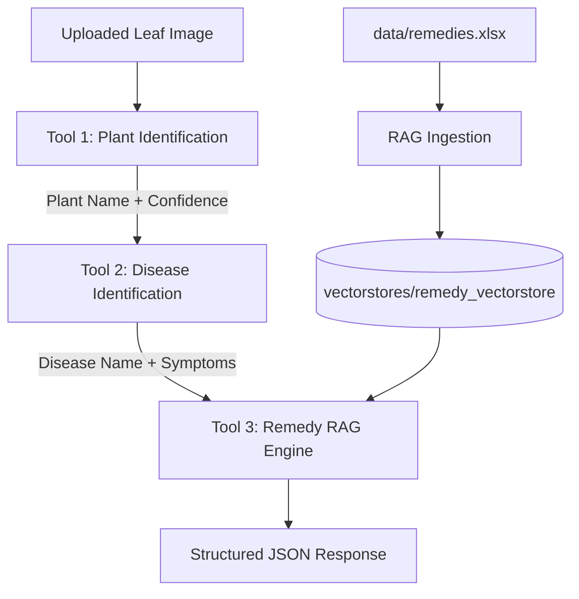

# Plant AI Application

A modular, multi-stage Plant AI application integrating TensorFlow/Keras computer vision models with FAISS-based Retrieval-Augmented Generation (RAG) for plant identification, disease diagnosis, and grounded remedy recommendations.

---

## 🌟 Architecture Overview



### Module Breakdown:
1. **Tool 1 — Plant Identification (`app/tools/plant_identifier.py`)**: Predicts crop type (Potato, Tomato, etc.) using Keras models and `crop_indices.json` index mappings. Enforces `PLANT_CONFIDENCE_THRESHOLD`.
2. **Tool 2 — Disease Identification (`app/tools/disease_identifier.py`)**: Predicts disease or healthy status using plant-specific TensorFlow models. Enforces `DISEASE_CONFIDENCE_THRESHOLD`.
3. **Tool 3 — Remedy Recommendation (`app/tools/remedy_retriever.py`, `app/rag/`)**: Queries `remedies.xlsx` knowledge base via FAISS vector database. Generates strictly grounded treatment, prevention, and horticultural care advice.
4. **Master Orchestrator (`app/tools/orchestrator.py`)**: Chains the pipeline together, short-circuiting on low confidence to prevent invalid diagnosis or ungrounded remedies.
5. **FastAPI Server (`app/main.py`, `app/api/routes.py`)**: REST endpoints serving tool pipelines and frontend client.

---

## 🚀 Getting Started

### 1. Installation

Install dependencies:
```bash
pip install -r requirements.txt
```

### 2. Knowledge Base Ingestion

Ingest `data/remedies.xlsx` into persistent FAISS vector database (`vectorstores/remedy_vectorstore`):
```bash
python app/rag/ingest.py
```

### 3. Running the Server

Start the FastAPI application:
```bash
uvicorn app.main:app --reload --port 8000
```
Open your browser at `http://localhost:8000` to interact with the web dashboard.

---

## 🧪 Testing

Run the full automated unittest suite:
```bash
python -m unittest discover tests
```

---

## 📑 API Endpoints

- `POST /api/identify-plant`: Upload image file -> returns plant name, scientific name, confidence score.
- `POST /api/identify-disease`: Upload image file + optional plant_name form data -> returns disease name, confidence score, symptoms description.
- `POST /api/get-remedies`: JSON payload `{ "plant_name": "Tomato", "disease_name": "Early Blight" }` -> returns grounded remedies.
- `POST /api/analyze`: Upload leaf image -> executes full end-to-end pipeline with confidence guardrails.
- `GET /health`: Health check endpoint.
