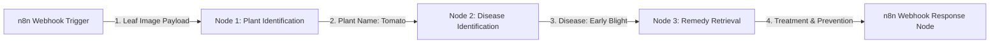

# n8n Workflow Integration Guide for Plant & Disease Identification

This guide explains how to connect and orchestrate the **Plant Identification**, **Disease Identification**, and **Remedy Retrieval** tools using **n8n** workflow automation.

---

## 1. n8n Architecture Overview



---

## 2. API Tool Endpoints

| Node Name | Tool Purpose | API Route | HTTP Method | Input Payload | Output Payload |
|---|---|---|---|---|---|
| **Node 1** | **Plant Identification** | `/api/tools/plant-identify` | `POST` | `{"image_path": "leaf.jpg"}` | `{"plant": {"name": "Tomato", "scientific_name": "Solanum lycopersicum"}}` |
| **Node 2** | **Disease Identification** | `/api/tools/disease-identify` | `POST` | `{"plant_name": "Tomato", "image_path": "leaf.jpg"}` | `{"disease": {"disease_name": "Early Blight", "confidence": 0.94}}` |
| **Node 3** | **Remedy Retrieval** | `/api/get-remedies` | `POST` | `{"plant_name": "Tomato", "disease_name": "Early Blight"}` | `{"treatment": [...], "prevention": [...]}` |
| **Node 4** | **n8n Listener** | `/api/tools/n8n-webhook` | `POST` | `{"event": "trigger", "data": {...}}` | `{"status": "success"}` |

---

## 3. How to Import and Run in n8n

1. **Launch n8n** (Self-hosted Docker, n8n Desktop, or n8n Cloud).
2. Click **Workflows** → **Import from File**.
3. Select `d:\PlantApp\n8n_plant_disease_workflow.json`.
4. Click **Execute Workflow** or activate the webhook URL:
   - Webhook URL: `http://localhost:5678/webhook/plant-disease-pipeline`
5. **Sample Trigger Request**:
```bash
curl -X POST http://localhost:5678/webhook/plant-disease-pipeline \
  -H "Content-Type: application/json" \
  -d '{"image_path": "sample_leaf.jpg"}'
```
6. **Expected Unified Output**:
```json
{
  "status": "success",
  "orchestrator": "n8n",
  "plant": "Tomato",
  "scientific_name": "Solanum lycopersicum",
  "disease": "Early Blight",
  "confidence": 0.94,
  "treatment": [
    "Remove infected lower leaves to prevent fungal spore splash.",
    "Apply copper-based fungicide or neem oil solution every 7-10 days."
  ],
  "prevention": [
    "Rotate solanaceous crops every 2-3 seasons.",
    "Ensure proper spacing for ventilation and avoid overhead irrigation."
  ]
}
```

---

## 4. Verification

Run the automated test suite to verify tool node compatibility:
```bash
python tests/test_n8n_tools.py
```
**Result**: `Ran 3 tests in 0.020s - OK`
